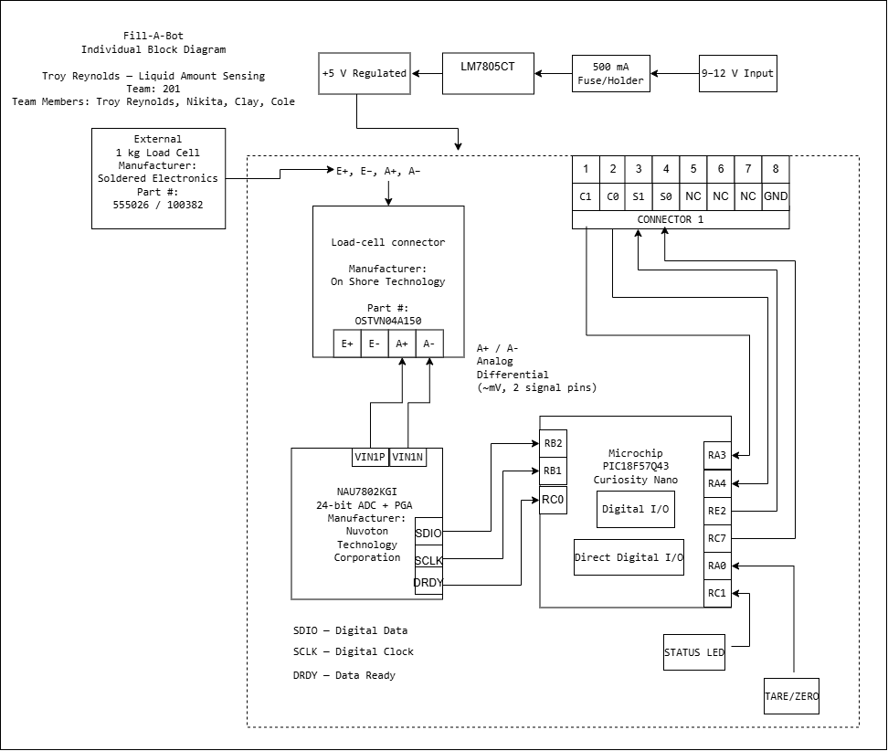

# Individual Block Diagram

## Overview

The individual block diagram documents the electrical design of the Liquid Amount Sensing subsystem for Fill-A-Bot. The subsystem uses an external 1 kg load cell to measure the combined weight of the container and liquid. The small differential signal produced by the load cell is measured by a Nuvoton NAU7802KGI 24-bit sigma-delta ADC with a programmable gain amplifier.

A Microchip PIC18F57Q43 Curiosity Nano processes the weight measurement and interfaces with the Fill-A-Bot main controller using a four-wire direct digital interface. Two command inputs, C1 and C0, select one of four weight presets, while two status outputs, S1 and S0, report the current state of the Liquid Amount Sensing subsystem.

The subsystem also includes local 5 V power regulation, a load-cell connector, ADC interface circuitry, a tare/zero pushbutton, status LED, GPIO expansion, and test points.

## Individual Block Diagram

**Figure 1:** Individual block diagram for the Fill-A-Bot Liquid Amount Sensing subsystem.

## Power

The subsystem accepts a 9–12 V DC input through a 2-position screw-terminal connector. The input passes through a 500 mA fuse and fuse holder before reaching an LM7805CT linear voltage regulator.

The LM7805CT converts the input voltage to a regulated 5 V supply for the subsystem. A 0.33 µF capacitor is connected at the regulator input and a 0.1 µF capacitor is connected at the regulator output to help stabilize the regulator.

A local 5 V selection jumper connects the locally regulated supply to the +5V_BOARD rail used by the subsystem electronics.

The simplified power path shown in the block diagram is:

**9–12 V Input → 500 mA Fuse/Holder → LM7805CT → +5 V Regulated**

## Liquid Amount Sensing

The subsystem uses an external Adafruit Industries 4540 1 kg load cell to measure the combined weight of the container and liquid.

The Adafruit 4540 is external to the subsystem PCB and connects to the PCB through the 4-position load-cell interface.

The load-cell interface uses four electrical connections:

- **E+** — Positive bridge excitation
- **E−** — Negative bridge excitation
- **A+** — Positive differential measurement signal
- **A−** — Negative differential measurement signal

The external load cell connects to the sensor PCB through an On Shore Technology OSTVN04A150 4-position load-cell connector.

The E+ and E− connections provide excitation for the load-cell bridge. The A+ and A− connections form the differential analog measurement pair.

The A+ and A− signals are routed through the analog input circuitry to the NAU7802KGI. Two 47 Ω series resistors and a 0.1 µF capacitor provide filtering for the low-level differential signal before analog-to-digital conversion.

The block diagram simplifies the external load-cell connection as a single functional connection labeled:

**E+, E−, A+, A−**

The load cell remains external to the PCB, while the NAU7802 ADC interface, PIC18F57Q43 connections, team communication interface, and subsystem PCB architecture are contained within the Liquid Amount Sensing subsystem.

## NAU7802 ADC Interface

The Nuvoton NAU7802KGI is a 24-bit sigma-delta ADC with a programmable gain amplifier. It amplifies and converts the small differential voltage produced by the load cell into digital measurement data that can be processed by the PIC18F57Q43.

The load-cell differential measurement signals connect to the NAU7802 through:

- **VIN1P** — Positive differential ADC input
- **VIN1N** — Negative differential ADC input

The NAU7802 connects locally to the Curiosity Nano using three digital signals:

| **NAU7802 Signal** | **PIC18F57Q43 Pin** | **Purpose** |
| --- | --- | --- |
| SDIO | RB2 | Digital data and ADC configuration |
| SCLK | RB1 | Digital clock |
| DRDY | RC0 | Indicates when a new ADC conversion is ready |

The SDIO and SCLK lines use 4.7 kΩ pull-up resistors.

This ADC interface is local to the Liquid Amount Sensing subsystem and is separate from the direct digital communication used between the Fill-A-Bot subsystem boards.

## Team Communication

The Liquid Amount Sensing subsystem communicates with the Fill-A-Bot main controller using four direct digital HIGH/LOW signals rather than UART or I2C.

Two signals, C1 and C0, are inputs from the main controller and form a two-bit weight command. Two signals, S1 and S0, are outputs from the Liquid Amount Sensing subsystem and form a two-bit weight status.

The 8-position team connector uses the following connections:

| **Connector Pin** | **Signal** | **PIC Pin** | **Direction** | **Purpose** |
| --- | --- | --- | --- | --- |
| Pin 1 | C1 | RA3 | Input | Weight-command bit 1 |
| Pin 2 | C0 | RA4 | Input | Weight-command bit 0 |
| Pin 3 | S1 | RE2 | Output | Weight-status bit 1 |
| Pin 4 | S0 | RC7 | Output | Weight-status bit 0 |
| Pin 5 | NC | — | — | Unused |
| Pin 6 | NC | — | — | Unused |
| Pin 7 | NC | — | — | Unused |
| Pin 8 | GND | GND | — | Common ground between subsystem boards |

### Weight Command

C1 and C0 allow the main controller to select one of four weight presets.

| **C1 C0** | **Command** |
| --- | --- |
| 00 | Preset 1 |
| 01 | Preset 2 |
| 10 | Preset 3 |
| 11 | Preset 4 |

C1 and C0 connect directly to PIC pins RA3 and RA4.

The command path is:

**Main Controller → C1/C0 → RA3/RA4 → PIC18F57Q43**

### Weight Status

S1 and S0 allow the Liquid Amount Sensing subsystem to report its current state to the main controller.

| **S1 S0** | **Status** |
| --- | --- |
| 00 | Not ready |
| 01 | Below target |
| 10 | Target reached |
| 11 | Error |

S1 and S0 are generated by PIC pins RE2 and RC7.

The S1 and S0 outputs will be initialized LOW by the subsystem software.

The status path is:

**PIC18F57Q43 → RE2/RC7 → S1/S0 → Main Controller**

The team connector does not carry subsystem power. Pins 1 through 4 are used for direct digital communication, Pins 5 through 7 are unused, and Pin 8 provides the common ground connection between the subsystem and main controller.

## Tare / Zero Input

A momentary pushbutton is connected to PIC pin RA0 and is used as the TARE/ZERO input.

The input uses a 10 kΩ pull-up resistor. When the button is not pressed, the input is held HIGH. When the button is pressed, RA0 is connected to ground and becomes LOW.

The PIC can detect the button press and establish the current load-cell measurement as the zero or tare reference. This allows the weight of the empty container to be removed from subsequent liquid measurements.

A 1 µF capacitor is included to help filter and debounce the pushbutton signal.

## Status LED

A green status LED is controlled by PIC pin RC1 through a 1.2 kΩ current-limiting resistor.

The LED provides a visual indication that can be controlled by software to show subsystem status, measurement activity, tare completion, or debugging information.

## GPIO Expansion

A 6-pin expansion header provides four additional general-purpose I/O connections labeled GPIO1 through GPIO4.

The expansion header also provides +5V_BOARD and GND for connection to additional external hardware if required.

## Debugging and Test Points

Five test points are included on the subsystem PCB to provide convenient access to important power and ADC-related signals during subsystem testing and verification.

The status LED, tare/zero pushbutton, GPIO expansion header, and test points provide additional hardware access for testing and debugging without changing the normal operation of the Liquid Amount Sensing subsystem.

## Design Summary

The Liquid Amount Sensing subsystem measures liquid weight using an external 1 kg load cell and the NAU7802 ADC and processes the measurement with the PIC18F57Q43.

The measurement path is:

**External Load Cell → Load-Cell Connector → Analog Input Circuitry → NAU7802 → PIC18F57Q43**

The command path is:

**Main Controller → C1/C0 → RA3/RA4 → PIC18F57Q43**

The status path is:

**PIC18F57Q43 → RE2/RC7 → S1/S0 → Main Controller**

The power path is:

**9–12 V Input → 500 mA Fuse → LM7805CT → +5V_LOCAL → JP2 → +5V_BOARD**

The four-wire digital interface allows the main controller to select one of four weight presets and allows the Liquid Amount Sensing subsystem to report whether it is not ready, below the target, at the target, or in an error state.

## Source Files

The editable source file used to create the individual block diagram is available below:

- [Download the Individual Block Diagram Draw.io Source](individual-block-diagram.drawio.xml)
- [Download the Individual Block Diagram PNG](individual-block-diagram.png)
