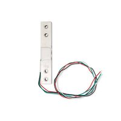
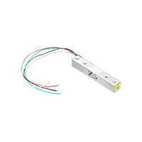
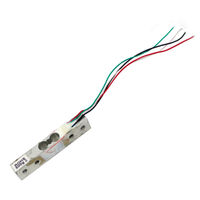
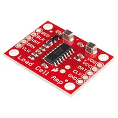
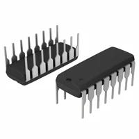
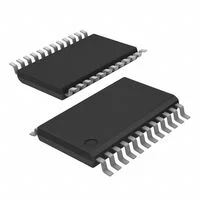

# Component Selection
**Individual Subsystem: Liquid Amount Sensing**

The Liquid Amount Sensing subsystem measures the amount of liquid in the
Fill-A-Bot using a load cell. The small differential signal from the load cell
must be amplified and converted into digital data before it can be processed
by the PIC18F57Q43 microcontroller. The following sections compare potential
load cells and load-cell ADC/amplifier solutions for this subsystem.

## Load Cell Selection

*Table 1: Load cell component selection*

**Load Cell / Weight Sensor**

| **Solution** | **Pros** | **Cons** |
| --- | --- | --- |
|  **Option 1** Soldered Electronics 555026 / 100382 1 kg Load Cell $15.96/each [Link to product](https://www.digikey.com/en/products/detail/soldered-electronics/555026/29271488) | \* 1 kg maximum load is appropriate for the liquid container \* Operates from 5 V to 10 V \* 2 ±0.1 mV/V output sensitivity \* Wheatstone bridge design works with a high-resolution load-cell ADC \* Detailed electrical characteristics are available | \* More expensive than the Adafruit option \* Requires an ADC/amplifier to measure the small output signal \* Requires calibration |
|  **Option 2** Adafruit Industries 4540 1 kgf Load Cell $3.95/each [Link to product](https://www.digikey.com/en/products/detail/adafruit-industries-llc/4540/12323569) | \* 1 kg measurement range is appropriate for the project \* Lowest-cost load cell of the three options \* Compact load-cell design | \* Requires an external ADC/amplifier \* Requires calibration before accurate measurements can be made \* Less detailed electrical documentation |
|  **Option 3** Seeed Technology 314990000 0-500 g Load Cell $17.00/each [Link to product](https://www.digikey.com/en/products/detail/seeed-technology-co-ltd/314990000/5488115) | \* Designed for electronic weighing applications \* Recommended 5 V excitation matches the subsystem supply \* 0.5 ±0.1 mV/V output sensitivity \* ±0.05% full-scale nonlinearity | \* Maximum capacity is only 500 g \* Container plus liquid could exceed the 500 g limit \* Most expensive load-cell option \* Requires an external ADC/amplifier |

**Choice:** Option 1: Soldered Electronics 555026 / 100382 1 kg Load Cell

**Rationale:** The Soldered Electronics 555026 was selected because its
1 kg maximum load provides an appropriate measurement range for the liquid
container used in the Fill-A-Bot. The sensor operates from a 5 V to 10 V
excitation supply and produces a 2 ±0.1 mV/V differential output from its
Wheatstone bridge. This allows the load cell to operate from the subsystem's
regulated 5 V supply and interface with a high-resolution bridge-sensor ADC.
Its documented electrical characteristics, 1 kg measurement range, and
compatibility with the selected NAU7802 load-cell ADC make it well suited
for the Liquid Amount Sensing subsystem.

## Load Cell ADC / Amplifier Selection

*Table 2: Load cell ADC/amplifier component selection*

**Load Cell ADC / Amplifier**

| **Solution** | **Pros** | **Cons** |
| --- | --- | --- |
|  **Option 1** SparkFun Electronics SEN-13879 HX711 Load Cell Amplifier $11.50/each [Link to product](https://www.digikey.com/en/products/detail/sparkfun-electronics/13879/6202732) | \* 24-bit ADC designed for weigh scales and bridge sensors \* Built-in low-noise programmable gain amplifier \* Selectable gain of 32, 64, or 128 \* Operates from 2.6 V to 5.5 V \* Complete breakout board simplifies prototyping | \* More expensive than a bare ADC IC \* Maximum standard sample rate is 80 SPS \* Breakout-board implementation is not appropriate for direct integration into the final subsystem PCB \* Requires software calibration |
|  **Option 2** Nuvoton Technology NAU7802KGI 24-bit Load Cell ADC $2.26/each [Link to product](https://www.digikey.com/en/products/detail/nuvoton-technology-corporation/NAU7802KGI/2769783) | \* 24-bit sigma-delta ADC designed for bridge and strain-gauge sensors \* Programmable gain from 1 to 128 \* Digital SDIO/SCLK interface to the microcontroller \* Operates from 2.7 V to 5.5 V \* Through-hole 16-PDIP package \* Integrates directly onto the PCB \* Significantly less expensive than the HX711 module | \* Bare IC requires additional support circuitry \* More software configuration is required \* Requires configuration before measurements can be taken |
|  **Option 3** Texas Instruments ADS1232IPWR 24-bit Bridge Sensor ADC $8.50/each [Link to product](https://www.digikey.com/en/products/detail/texas-instruments/ADS1232IPWR/1689138) | \* 24-bit ADC specifically designed for bridge sensors and weigh scales \* Low-noise programmable gain amplifier \* Selectable gains of 1, 2, 64, and 128 \* Two differential input channels \* Operates from 2.7 V to 5.3 V | \* Surface-mount 24-TSSOP package is more difficult to prototype \* Requires additional external support components \* More complex PCB layout \* More expensive than the NAU7802 |

**Choice:** Option 2: Nuvoton Technology NAU7802KGI

**Rationale:** The Nuvoton Technology NAU7802KGI was selected because it
combines a 24-bit sigma-delta ADC with a programmable gain amplifier designed
for precision bridge and strain-gauge measurements. Its programmable gain
allows the very small differential output of the load cell to be amplified
before analog-to-digital conversion. The device operates from 2.7 V to 5.5 V,
making it compatible with the subsystem's regulated 5 V supply. The
NAU7802KGI is available in a 16-PDIP through-hole package, allowing the ADC
to be integrated directly onto the subsystem PCB without using a daughter
board. At approximately $2.26 per device, it is also significantly less
expensive than the HX711 breakout board and ADS1232 option. These
characteristics make the NAU7802KGI the best fit for the final Liquid Amount
Sensing subsystem.

## Pin Table

*Table 3: Liquid Amount Sensing subsystem pin connections*

| **Component** | **Pin / Signal** | **Connection** | **Purpose** |
| --- | --- | --- | --- |
| Soldered 555026 Load Cell | E+ / Input+ | +5V_BOARD | Positive load-cell bridge excitation |
| Soldered 555026 Load Cell | E- / Input- | GND | Negative load-cell bridge excitation |
| Soldered 555026 Load Cell | A+ / Output+ | R2 → NAU7802 VIN1P | Positive differential load-cell signal |
| Soldered 555026 Load Cell | A- / Output- | R1 → NAU7802 VIN1N | Negative differential load-cell signal |
| NAU7802KGI | VIN1P | Load-cell A+ through 47 Ω R2 | Positive differential ADC input |
| NAU7802KGI | VIN1N | Load-cell A- through 47 Ω R1 | Negative differential ADC input |
| NAU7802KGI | SDIO | PIC18F57Q43 RB2 | Bidirectional digital ADC data |
| NAU7802KGI | SCLK | PIC18F57Q43 RB1 | Digital clock from PIC to ADC |
| NAU7802KGI | DRDY | PIC18F57Q43 RC0 | Indicates new ADC conversion is ready |
| PIC18F57Q43 | RA3 | J1 Pin 1 - TEAM_IN | Direct HIGH/LOW input from team controller |
| PIC18F57Q43 | RA4 | J1 Pin 2 - TEAM_OUT | Direct HIGH/LOW output to team controller |
| PIC18F57Q43 | RA0 | SW1 TARE/ZERO | Tare/zero pushbutton input |
| PIC18F57Q43 | RC1 | R3 → LED1 | Status LED output |
| Team Connector J1 | Pin 1 | TEAM_IN | Direct digital input |
| Team Connector J1 | Pin 2 | TEAM_OUT | Direct digital output |
| Team Connector J1 | Pins 3-7 | NC | Unused |
| Team Connector J1 | Pin 8 | GND | Common ground between team subsystems |
