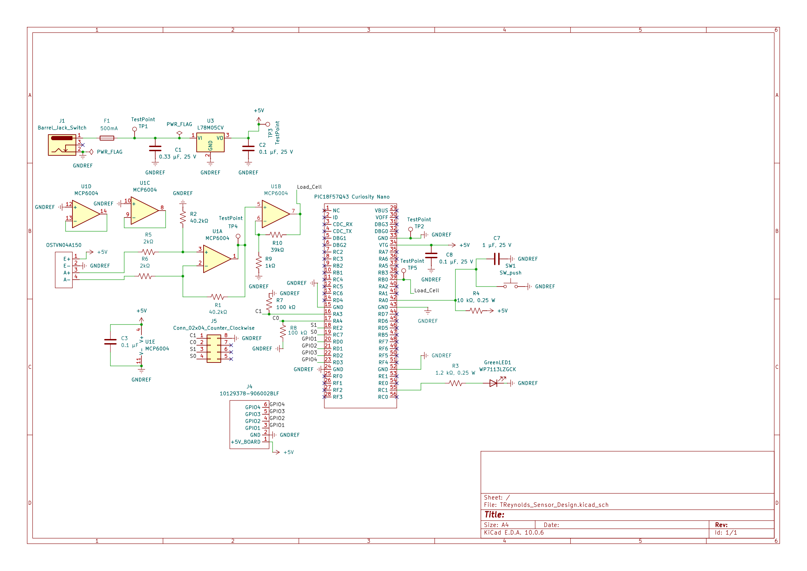

# Schematic

## Overview

The Liquid Amount Sensing subsystem measures the amount of liquid dispensed by the Fill-A-Bot using an external 1 kg load cell. The load cell produces a small differential analog voltage that is amplified by an MCP6004 quad operational amplifier before being measured by the PIC18F57Q43 Curiosity Nano.

The analog amplifier is designed for approximately 804 V/V total gain. The load cell has a sensitivity of approximately 1.0 mV/V and is excited with 5 V, producing approximately 5 mV differential output at full scale. The amplifier converts the full-scale load-cell signal to approximately 4.02 V.

A Microchip PIC18F57Q43 Curiosity Nano processes the amplified load-cell measurement, controls the tare/zero and status functions, and communicates with the Fill-A-Bot main controller using four direct digital signals.

The subsystem also contains 5 V power regulation, input protection, load-cell interfacing, analog signal conditioning, a team connector, GPIO expansion header, status LED, tare/zero pushbutton, and test points.

## Final Schematic

**Figure 1:** Final schematic for the Fill-A-Bot Liquid Amount Sensing subsystem.

A PDF version of the final schematic is also available:

[Download the Liquid Amount Sensing Schematic PDF](TReynolds_Liquid_Amount_Sensing_Schematic.pdf)

The complete final KiCad ECAD project is also available as a ZIP archive. The archive contains the KiCad project files, schematic, PCB layout, project-specific symbol library, footprint library, and associated library tables required to open and edit the design.

[Download the Final Liquid Amount Sensing ECAD Project](TReynolds_Liquid_Amount_Sensing_ECAD_Final.zip)

## Power Regulation

The subsystem receives external DC power through J1, a PJ-102AH barrel jack.

The incoming supply passes through F1, a 500 mA fuse, which provides overcurrent protection before the supply reaches the voltage regulator.

U3 is an L78M05CV linear voltage regulator that produces the regulated +5 V supply used by the subsystem.

The regulator support capacitors are:

- **C1 = 0.33 µF, 25 V** on the regulator input
- **C2 = 0.1 µF, 25 V** on the regulator output

TP1 provides a convenient test location on the regulator input side, while TP3 provides access to the regulated +5 V output.

The power path is:

**DC Input → 500 mA Fuse → L78M05CV → +5 V**

The regulated +5 V supply powers the load cell, MCP6004 amplifier circuitry, Curiosity Nano, and supporting circuitry.

## Load Cell Interface

The subsystem uses an external Adafruit Industries 4540 1 kg load cell.

The load cell connects to the PCB through J2, an On Shore Technology OSTVN04A150 4-position screw-terminal connector.

The four load-cell connections are:

| **Signal** | **Purpose** |
| --- | --- |
| E+ | Positive bridge excitation |
| E- | Negative bridge excitation |
| A+ | Positive differential measurement output |
| A- | Negative differential measurement output |

E+ is connected to the regulated +5 V supply and E- is connected to ground.

A+ and A- carry the differential measurement signal generated by the load cell.

## Load Cell Full-Scale Signal

The load cell sensitivity is approximately:

**Sensitivity = 1.0 mV/V**

With a 5 V excitation voltage:

**V_DIFF,FS = Sensitivity × V_EXC**

**V_DIFF,FS = (1.0 mV/V)(5 V)**

**V_DIFF,FS = 5 mV**

Therefore, at approximately 1 kg full-scale load, the expected differential signal is:

**A+ - A- ≈ 5 mV**

Because this voltage is too small to use directly with the microcontroller, the MCP6004 amplifier increases the signal to approximately 4 V at full scale.

## MCP6004 Analog Amplifier

U1 is an MCP6004 quad operational amplifier.

Two amplifier stages are used to amplify the small differential signal from the load cell.

The first stage uses U1A and the following resistors:

- **R1 = 40.2 kΩ**
- **R2 = 40.2 kΩ**
- **R5 = 2 kΩ**
- **R6 = 2 kΩ**

The matched resistor ratios are:

**R1 / R6 = 40.2 kΩ / 2 kΩ = 20.1**

**R2 / R5 = 40.2 kΩ / 2 kΩ = 20.1**

Therefore, the first-stage differential gain is approximately:

**G1 = 20.1**

For a 5 mV full-scale differential load-cell signal:

**V1 = 5 mV × 20.1**

**V1 ≈ 100.5 mV**

## Second Amplifier Stage

The second amplification stage uses U1B.

The gain-setting resistors are:

- **R9 = 1 kΩ**
- **R10 = 39 kΩ**

The non-inverting amplifier gain is:

**G2 = 1 + (R10 / R9)**

**G2 = 1 + (39 kΩ / 1 kΩ)**

**G2 = 40**

The total analog gain is therefore:

**G_TOTAL = G1 × G2**

**G_TOTAL = 20.1 × 40**

**G_TOTAL = 804**

At the approximately 5 mV full-scale load-cell output:

**V_OUT,FS = 5 mV × 804**

**V_OUT,FS ≈ 4.02 V**

Therefore, the intended conversion is approximately:

**1 kg → 5 mV differential → 4.02 V amplified output**

This provides a much larger analog signal for the PIC18F57Q43 to measure.

## Load Cell Signal to Microcontroller

The amplified analog output is labeled **Load_Cell** in the schematic.

The Load_Cell signal is connected to **RB0 (pin 39)** on the PIC18F57Q43 Curiosity Nano.

The PIC can use this amplified voltage to determine the measured load after calibration.

The measurement signal path is:

**External Load Cell → J2 → MCP6004 First Stage → MCP6004 Second Stage → Load_Cell → PIC18F57Q43**

## MCP6004 Power and Bypass

The MCP6004 is powered from the regulated +5 V supply.

C3 is a **0.1 µF, 25 V bypass capacitor** connected across the MCP6004 power supply.

This capacitor helps suppress high-frequency supply noise and provides local decoupling for the analog amplifier.

Unused MCP6004 amplifier sections are configured so that they are not left with uncontrolled floating inputs.

## Team Communication

J5 is the 2×4 team connector used to interface the Liquid Amount Sensing subsystem with the Fill-A-Bot main controller.

The subsystem uses four direct digital HIGH/LOW communication signals:

- **C1**
- **C0**
- **S1**
- **S0**

C1 and C0 are command inputs to the Liquid Amount Sensing subsystem.

S1 and S0 are status outputs from the Liquid Amount Sensing subsystem.

The schematic connects these signals to the PIC18F57Q43 for communication with the main controller.

The connector also provides a common ground connection between subsystem boards.

## Tare / Zero Circuit

SW1 is a momentary pushbutton used to tare or zero the scale.

The tare/zero circuit is connected to PIC pin **RA0**.

The circuit includes:

- **SW1 = B3F-1020 tactile pushbutton**
- **R4 = 10 kΩ, 1%, 0.25 W**
- **C7 = 1 µF, 25 V**

R4 provides the pull-up to +5 V.

When SW1 is pressed, the input is pulled to ground.

C7 provides filtering/debounce for the pushbutton signal.

The software can detect the button press and store the current load-cell measurement as the zero reference. This allows the weight of the empty container to be removed from subsequent liquid measurements.

## Status LED

LED1 is a green status/debug LED controlled by the PIC18F57Q43.

The LED circuit consists of:

- **R3 = 1.2 kΩ, 1%, 0.25 W**
- **LED1 = Kingbright WP7113LZGCK green LED**

R3 limits the LED current.

The LED can be used by software to indicate subsystem status, measurement activity, tare completion, or debugging information.

## Curiosity Nano Supply Filtering

C8 is a **0.1 µF, 25 V bypass capacitor** associated with the Curiosity Nano supply.

The capacitor helps reduce power-supply noise near the microcontroller.

## Additional Bias Resistors

R7 and R8 are **100 kΩ, 1%, 0.25 W** resistors included in the digital interface area of the design.

These resistors provide defined logic states for their associated signals and help prevent floating microcontroller inputs.

## GPIO Expansion

J4 is a **10129378-906002BLF 1×6 header** that provides additional access to the subsystem.

The header provides:

- GPIO1
- GPIO2
- GPIO3
- GPIO4
- +5 V
- GND

These connections provide access to additional PIC18F57Q43 I/O for testing, debugging, or future expansion.

## Test Points

Five test points are included in the PCB design:

- **TP1**
- **TP2**
- **TP3**
- **TP4**
- **TP5**

The test points provide convenient measurement access during subsystem testing and debugging.

They allow important power, ground, analog, and microcontroller signals to be measured without modifying the normal PCB wiring.

## PCB Design

The subsystem is implemented as a two-layer PCB with through-hole components used throughout most of the design.

A ground copper zone is used to provide a low-impedance common ground connection across the board.

The final PCB design was checked using the KiCad Design Rules Checker.

The final DRC results show:

- **0 violations**
- **0 unconnected items**
- **0 schematic parity errors**

The PCB includes through-hole test points and accessible connectors to simplify subsystem testing, troubleshooting, and integration.

## Design Summary

The Liquid Amount Sensing subsystem converts the mechanical force applied to the external 1 kg load cell into an amplified analog voltage that can be measured by the PIC18F57Q43.

The load-cell measurement path is:

**External 1 kg Load Cell → J2 → MCP6004 Differential Amplifier → MCP6004 Second Amplifier Stage → Load_Cell → PIC18F57Q43**

The approximate full-scale signal conversion is:

**1 kg → 5 mV → Gain of 804 → 4.02 V**

The power path is:

**DC Barrel Jack → 500 mA Fuse → L78M05CV → +5 V**

The subsystem also provides direct digital communication with the Fill-A-Bot main controller, a tare/zero pushbutton, status LED, GPIO expansion, and multiple test points.

The resulting design provides the Fill-A-Bot with a dedicated subsystem for measuring liquid weight, zeroing the empty container, processing the amplified load-cell signal, and communicating measurement status with the rest of the Fill-A-Bot system.
