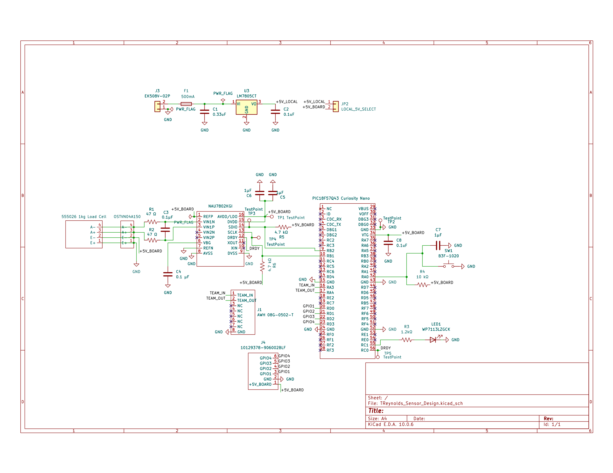

# Schematic

## Overview

The Liquid Amount Sensing subsystem measures the amount of liquid dispensed by the Fill-A-Bot using an external 1 kg load cell. The load cell produces a small differential analog voltage that is filtered and measured by a Nuvoton NAU7802KGI 24-bit sigma-delta ADC with a programmable gain amplifier.

A Microchip PIC18F57Q43 Curiosity Nano processes the digital weight measurement, controls the tare/zero and status functions, and communicates with the Fill-A-Bot main controller using a four-wire direct digital interface consisting of two weight-command inputs, C1 and C0, and two weight-status outputs, S1 and S0.

The subsystem also contains its own 5 V power regulation, input protection, load-cell interface, ADC support circuitry, team connector, GPIO expansion header, status LED, tare/zero pushbutton, and test points.

## Final Schematic

**Figure 1:** Final schematic for the Fill-A-Bot Liquid Amount Sensing subsystem.

A PDF version of the schematic is also available:

[Download the Liquid Amount Sensing Schematic PDF](liquid-amount-sensing-schematic.pdf)

## Power Regulation

The subsystem accepts a 9–12 V DC input through J3, a Dinkle EK508V-02P 2-position screw-terminal connector.

The incoming supply passes through F1, a 500 mA fuse, before reaching the LM7805CT linear voltage regulator.

The LM7805CT converts the 9–12 V input into a regulated 5 V supply.

The regulator support components include:

- **C1 = 0.33 µF, 25 V** on the regulator input
- **C2 = 0.1 µF, 25 V** on the regulator output
- **JP2** for connecting the locally regulated +5V_LOCAL rail to +5V_BOARD

The +5V_BOARD rail supplies the load-cell interface, NAU7802 circuitry, Curiosity Nano, and supporting components.

The power path is:

**9–12 V Input → 500 mA Fuse → LM7805CT → +5V_LOCAL → JP2 → +5V_BOARD**

## Load Cell Interface

The subsystem uses an external Soldered Electronics 555026 / 100382 1 kg load cell.

The external load cell connects to the PCB through an On Shore Technology OSTVN04A150 4-position screw-terminal connector.

The four load-cell connections are:

| **Signal** | **Purpose** |
| --- | --- |
| E+ | Positive bridge excitation |
| E− | Negative bridge excitation |
| A+ | Positive differential measurement output |
| A− | Negative differential measurement output |

E+ is connected to +5V_BOARD and E− is connected to ground.

A+ and A− carry the small differential measurement signal produced by the load cell.

## Analog Input Filtering

The differential load-cell output is filtered before entering the NAU7802.

The input network consists of:

- **R1 = 47 Ω, 0.25 W**
- **R2 = 47 Ω, 0.25 W**
- **C3 = 0.1 µF, 25 V**

R1 and R2 are placed in series with the two differential load-cell signal lines. C3 is connected across the differential input.

This network helps reduce high-frequency noise before the signal is amplified and converted by the NAU7802.

## NAU7802 Load-Cell ADC

The Nuvoton NAU7802KGI is a 24-bit sigma-delta analog-to-digital converter with a programmable gain amplifier.

The NAU7802 is used because the differential output from the load cell is very small and requires both amplification and high-resolution analog-to-digital conversion.

The primary load-cell inputs are:

- **VIN1P** — Positive differential input
- **VIN1N** — Negative differential input

Additional support circuitry includes:

- **C4 = 0.1 µF, 25 V**
- **C5 = 1 µF, 25 V**
- **C6 = 1 µF, 25 V**
- **R5 = 4.7 kΩ, 0.25 W**
- **R6 = 4.7 kΩ, 0.25 W**

C4 provides filtering for the ADC reference circuitry.

C5 and C6 provide local supply filtering and decoupling for the ADC circuitry.

R5 and R6 provide pull-up resistance for the NAU7802 digital interface.

## NAU7802 to Microcontroller Interface

The NAU7802 communicates locally with the PIC18F57Q43 Curiosity Nano using SDIO, SCLK, and DRDY.

| **NAU7802 Signal** | **PIC18F57Q43 Pin** | **Purpose** |
| --- | --- | --- |
| SDIO | RB2 | Bidirectional digital data and ADC configuration |
| SCLK | RB1 | Digital clock |
| DRDY | RC0 | Indicates that a new ADC conversion is ready |

The PIC uses these signals to configure the NAU7802 and retrieve converted load-cell measurements.

This interface is local to the Liquid Amount Sensing PCB and is separate from the direct digital communication used between the Fill-A-Bot subsystem boards.

## Team Communication

J1 is the 8-position team connector used to interface the Liquid Amount Sensing subsystem with the Fill-A-Bot main controller.

The subsystem uses four direct digital HIGH/LOW signals rather than UART or I2C between boards. Two signals, C1 and C0, are command inputs from the main controller. Two signals, S1 and S0, are status outputs from the Liquid Amount Sensing subsystem.

| **J1 Pin** | **Signal** | **PIC Pin** | **Direction** | **Purpose** |
| --- | --- | --- | --- | --- |
| 1 | C1 | RA3 | Input | Weight-command bit 1 |
| 2 | C0 | RA4 | Input | Weight-command bit 0 |
| 3 | S1 | RE2 | Output | Weight-status bit 1 |
| 4 | S0 | RC7 | Output | Weight-status bit 0 |
| 5 | NC | — | — | Not connected |
| 6 | NC | — | — | Not connected |
| 7 | NC | — | — | Not connected |
| 8 | GND | GND | — | Common ground between subsystem boards |

C1 and C0 form the two-bit weight-command input and connect directly to PIC pins RA3 and RA4.

The weight-command encoding is:

| **C1 C0** | **Command** |
| --- | --- |
| 00 | Preset 1 |
| 01 | Preset 2 |
| 10 | Preset 3 |
| 11 | Preset 4 |

S1 and S0 form the two-bit weight-status output from the Liquid Amount Sensing subsystem and are generated by PIC pins RE2 and RC7.

The weight-status encoding is:

| **S1 S0** | **Status** |
| --- | --- |
| 00 | Not ready |
| 01 | Below target |
| 10 | Target reached |
| 11 | Error |

The S1 and S0 outputs will be initialized LOW by the subsystem software.

The team connector does not distribute subsystem power. Pins 1 through 4 carry the four digital communication signals, Pins 5 through 7 are unused, and Pin 8 provides the common ground connection.

## Tare / Zero Circuit

SW1 is a momentary pushbutton used to tare or zero the scale.

The tare/zero circuit is connected to PIC pin RA0.

The circuit includes:

- **SW1 = Omron B3F-1020**
- **R4 = 10 kΩ, 0.25 W pull-up resistor**
- **C7 = 1 µF, 25 V debounce/filter capacitor**

When the button is not pressed, R4 holds RA0 HIGH.

When SW1 is pressed, RA0 is pulled to ground and becomes LOW.

The software can detect this state and store the current load-cell measurement as the zero reference. This allows the weight of the empty container to be removed from subsequent liquid measurements.

## Status LED

LED1 is a green status/debug LED controlled by PIC pin RC1.

The LED circuit consists of:

- **R3 = 1.2 kΩ, 0.25 W current-limiting resistor**
- **LED1 = Kingbright WP7113LZGCK green LED**

When RC1 is driven HIGH, current flows through R3 and LED1 to ground, turning the LED on.

The LED can be used by software to indicate subsystem status, measurement activity, tare completion, or debugging information.

## Curiosity Nano Supply Filtering

C8 is a **0.1 µF, 25 V** bypass capacitor connected to the Curiosity Nano supply.

The capacitor helps reduce power-supply noise near the microcontroller.

## GPIO Expansion

J4 is a 6-position GPIO expansion header.

The header provides:

- GPIO1
- GPIO2
- GPIO3
- GPIO4
- +5V_BOARD
- GND

These connections provide access to additional PIC18F57Q43 I/O if future expansion or additional testing is required.

## Test Points

Five test points are included in the design to provide access to important signals during testing and debugging.

The test points provide convenient locations for measuring power, ground, ADC-related signals, and DRDY without modifying the normal subsystem wiring.

## Design Summary

The Liquid Amount Sensing subsystem converts the mechanical force applied to the external 1 kg load cell into a digital weight measurement.

The measurement signal path is:

**External Load Cell → Load-Cell Connector → Analog Input Filter → NAU7802 24-bit ADC/PGA → PIC18F57Q43**

The weight-command path is:

**Main Controller → C1/C0 → RA3/RA4 → PIC18F57Q43**

The weight-status path is:

**PIC18F57Q43 → RE2/RC7 → S1/S0 → Main Controller**

The power path is:

**9–12 V Input → 500 mA Fuse → LM7805CT → +5V_LOCAL → JP2 → +5V_BOARD**

The resulting design provides the Fill-A-Bot with a dedicated subsystem for measuring liquid weight, selecting one of four commanded weight presets, zeroing the container weight, monitoring fill progress, and reporting the current weight status to the main controller.
