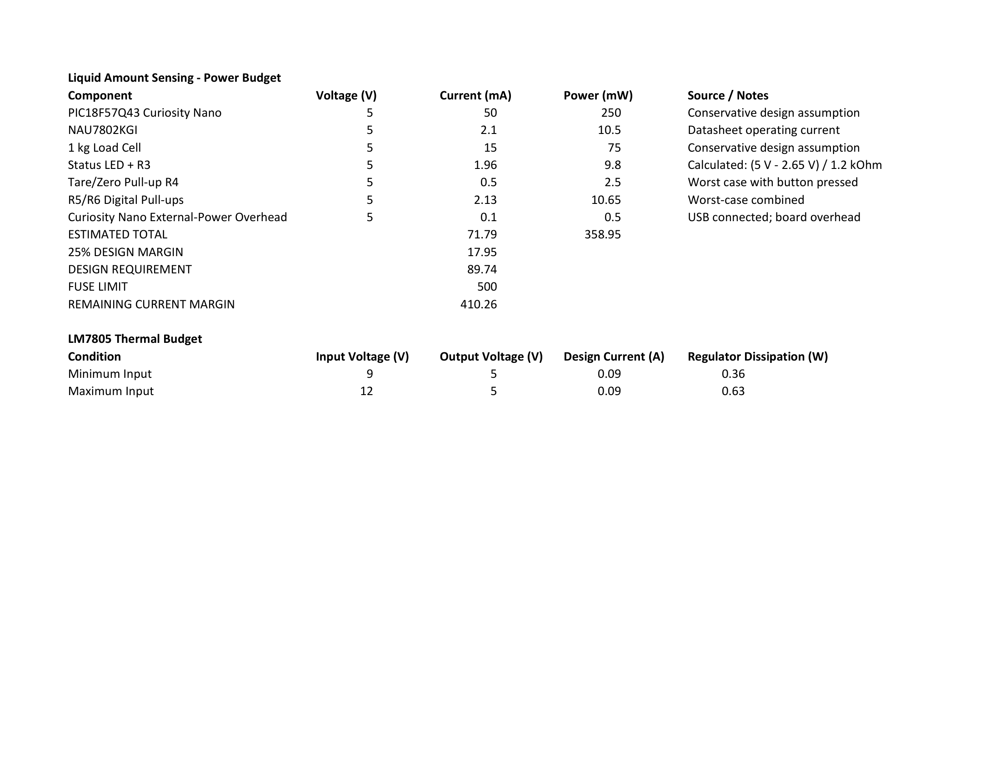

# Power Budget

## Overview

A power budget was created for the Fill-A-Bot Liquid Amount Sensing subsystem to estimate the current and power required by the components operating from the regulated 5 V supply.

The analysis includes the PIC18F57Q43 Curiosity Nano, NAU7802KGI load-cell ADC, external 1 kg load cell, status LED, tare/zero circuit, NAU7802 digital pull-up resistors, and Curiosity Nano external-power overhead.

A 25% design margin was added to the estimated operating current to provide additional capacity for component variation and operating conditions. The resulting design requirement was compared with the 500 mA fuse used to protect the subsystem.

The LM7805CT linear regulator was also evaluated at both the minimum 9 V input and maximum 12 V input to estimate regulator power dissipation.

## Power Budget

**Figure 1:** Power budget for the Fill-A-Bot Liquid Amount Sensing subsystem.

## Current and Power Analysis

The estimated operating current of the subsystem is **71.79 mA** at 5 V.

This corresponds to an estimated 5 V load power of:

**P = V × I**

**P = 5 V × 0.07179 A = 0.35895 W**

Therefore, the estimated subsystem load is approximately **358.95 mW**.

A 25% design margin was added to the estimated operating current:

**Design Margin = 71.79 mA × 0.25 = 17.95 mA**

The resulting design current requirement is:

**Design Requirement = 71.79 mA + 17.95 mA = 89.74 mA**

## Fuse Capacity

The subsystem uses a **500 mA fuse** on the power input.

The remaining current margin after including the 25% design margin is:

**Remaining Margin = 500 mA - 89.74 mA**

**Remaining Margin = 410.26 mA**

The estimated design requirement therefore remains well below the 500 mA fuse rating.

## LM7805 Thermal Analysis

Because the LM7805CT is a linear voltage regulator, the voltage difference between its input and 5 V output is dissipated as heat.

Regulator power dissipation was estimated using:

**P_D = (V_IN - V_OUT) × I**

For the thermal analysis, the design current was rounded to **0.09 A**.

### 9 V Input

At the minimum 9 V input:

**P_D = (9 V - 5 V) × 0.09 A**

**P_D = 0.36 W**

### 12 V Input

At the maximum 12 V input:

**P_D = (12 V - 5 V) × 0.09 A**

**P_D = 0.63 W**

The 12 V input condition produces the greatest estimated regulator dissipation and therefore represents the worst-case thermal condition evaluated in the power budget.

## Design Impact of the Power Budget

The power budget was used to determine whether the selected power components could safely support the Liquid Amount Sensing subsystem under expected operating conditions.

The calculated design requirement of approximately **89.74 mA**, including the 25% design margin, shows that the subsystem requires substantially less current than the **500 mA fuse rating**. This confirms that the selected fuse provides sufficient operating margin while still providing input protection for the subsystem.

The analysis also showed that current capacity is not the primary limitation of the power design. Instead, the largest concern is the power dissipated by the **LM7805CT linear regulator** as the input voltage increases. At a 12 V input, the regulator is estimated to dissipate approximately **0.63 W**, compared with approximately **0.36 W** at a 9 V input.

Based on these results, the subsystem power supply has sufficient current capacity, but regulator temperature should be monitored during hardware testing. Operating closer to the lower end of the 9–12 V input range will also reduce the power that must be dissipated by the LM7805CT.

## Conclusions

The Liquid Amount Sensing subsystem has an estimated operating current of **71.79 mA** and an estimated load power of **358.95 mW** at 5 V.

After applying a 25% design margin, the required current increases to approximately **89.74 mA**.

This is substantially below the **500 mA fuse limit**, leaving approximately **410.26 mA of current margin**.

The LM7805CT is expected to dissipate approximately **0.36 W at a 9 V input** and **0.63 W at a 12 V input** using the rounded 90 mA design current. The 12 V input therefore represents the highest thermal load considered in this analysis.

Based on the calculated current requirement, the selected power system provides sufficient electrical capacity for the Liquid Amount Sensing subsystem. The regulator thermal performance should also be verified during hardware testing, particularly when operating from the maximum 12 V input.

## Resources

The complete power budget is available in the following formats:

- [Download the Power Budget PDF](liquid-amount-sensing-power-budget.pdf)
- [Download the Power Budget Excel Spreadsheet](liquid-amount-sensing-power-budget.xlsx)
