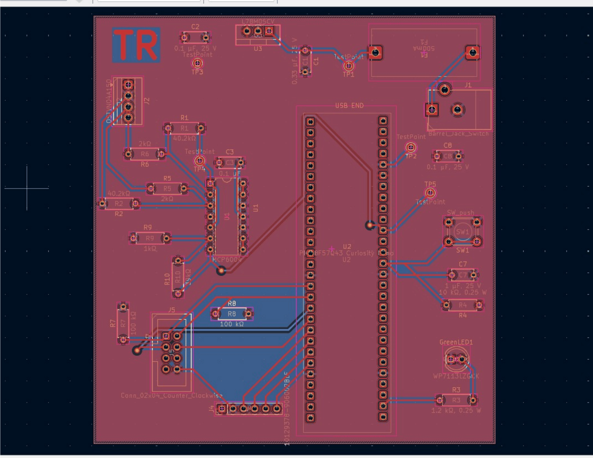

# PCB Design

## Final PCB Layout

The Liquid Amount Sensing subsystem was implemented as a two-layer printed circuit board using KiCad.

The final PCB contains the PIC18F57Q43 Curiosity Nano, MCP6004 load-cell amplifier circuitry, 5 V power regulation, load-cell interface, team communication connector, tare/zero pushbutton, status LED, GPIO expansion header, and multiple test points.

**Figure 1:** Final routed PCB layout for the Fill-A-Bot Liquid Amount Sensing subsystem.

A PDF version of the final PCB layout is also available:

[Download the Final PCB Layout PDF](TReynolds_Liquid_Amount_Sensing_PCB.pdf)

## Design Rule Check

The final PCB was checked using the KiCad Design Rules Checker.

The final DRC results were:

- **0 violations**
- **0 unconnected items**
- **0 schematic parity errors**

These results confirm that the final PCB layout contains no remaining KiCad design-rule violations or unrouted electrical connections.

## PCB Features

The final PCB includes:

- Two-layer PCB construction
- Through-hole components
- Front and back copper routing
- Ground copper zones
- PIC18F57Q43 Curiosity Nano
- MCP6004 analog load-cell amplifier
- L78M05CV 5 V voltage regulator
- 500 mA input fuse
- External load-cell connector
- Fill-A-Bot team communication connector
- Tare/zero pushbutton
- Status LED
- GPIO expansion header
- Multiple test points
- Silkscreen component references
- Board identification markings

## PCB Routing

The PCB uses both the front and back copper layers for signal routing.

A ground copper zone is used to provide a low-impedance common ground connection across the PCB. The board was routed with consideration for the analog load-cell signal path, power distribution, digital communication signals, and accessibility of the through-hole components.

The load-cell amplifier components are grouped near the load-cell connector and MCP6004. The PIC18F57Q43 Curiosity Nano is positioned near the center of the PCB to provide access to the analog, digital communication, status, and control circuitry.

## ECAD Project

The complete final KiCad ECAD project is provided below.

The archive contains the KiCad project files required to open, inspect, and edit the final Liquid Amount Sensing subsystem design.

[Download the Final Liquid Amount Sensing ECAD Project](TReynolds_Liquid_Amount_Sensing_ECAD_Final.zip)

## Manufacturing Files

The final Gerber and drill files are provided as a ZIP archive for PCB manufacturing and fabrication verification.

The manufacturing package contains the copper, solder mask, silkscreen, board outline, and drill information generated from the final KiCad PCB.

[Download the Final Gerber Files](TReynolds_Liquid_Amount_Sensing_Gerbers_Final.zip)

## Final Design Summary

The final PCB implements the complete Fill-A-Bot Liquid Amount Sensing subsystem on a two-layer printed circuit board.

The PCB provides the electrical connections required for:

- Load-cell measurement
- Analog signal amplification
- PIC18F57Q43 processing
- 5 V regulated power
- Fill-A-Bot subsystem communication
- Tare/zero control
- Status indication
- Testing and debugging

The final KiCad Design Rules Check reports **0 violations, 0 unconnected items, and 0 schematic parity errors**.
